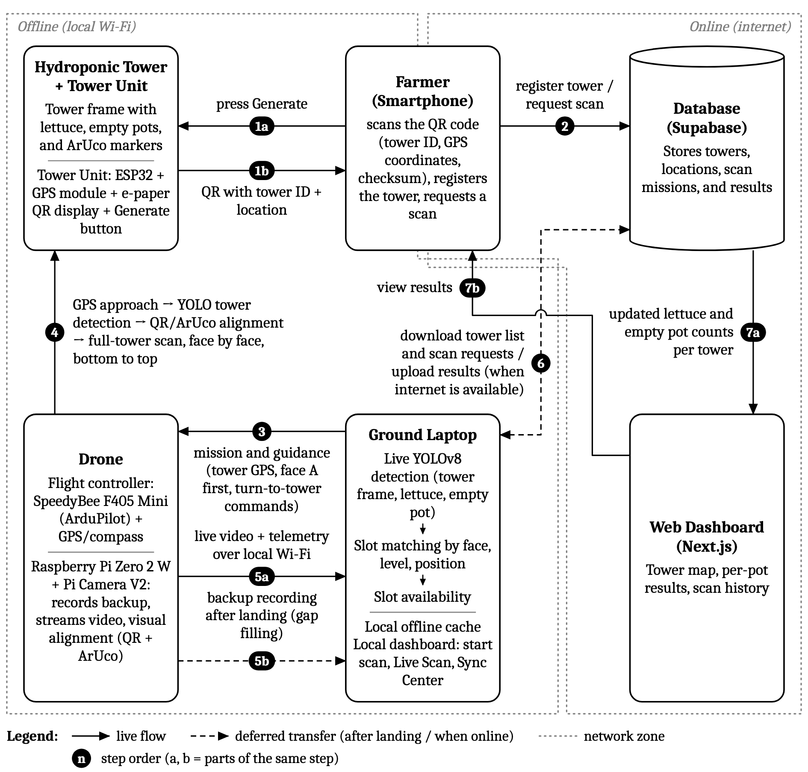
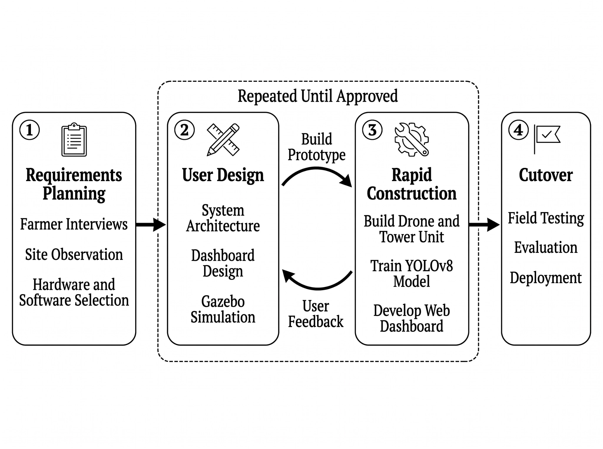
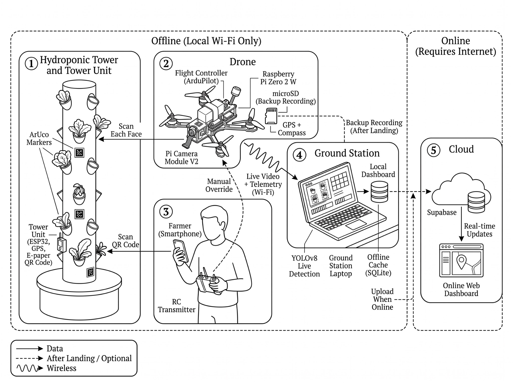
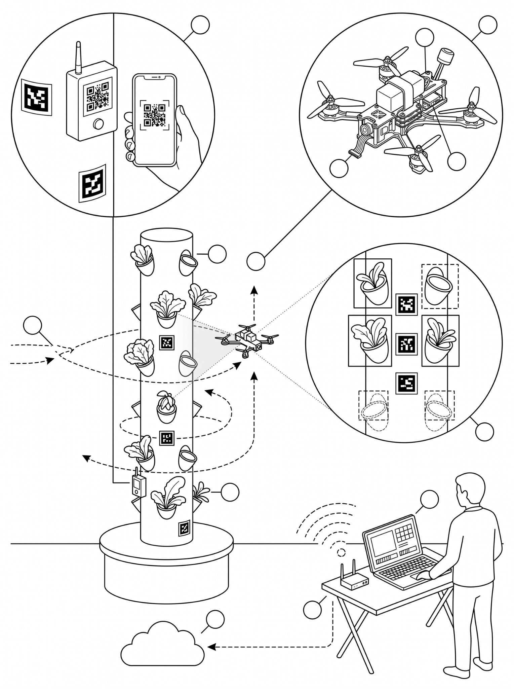
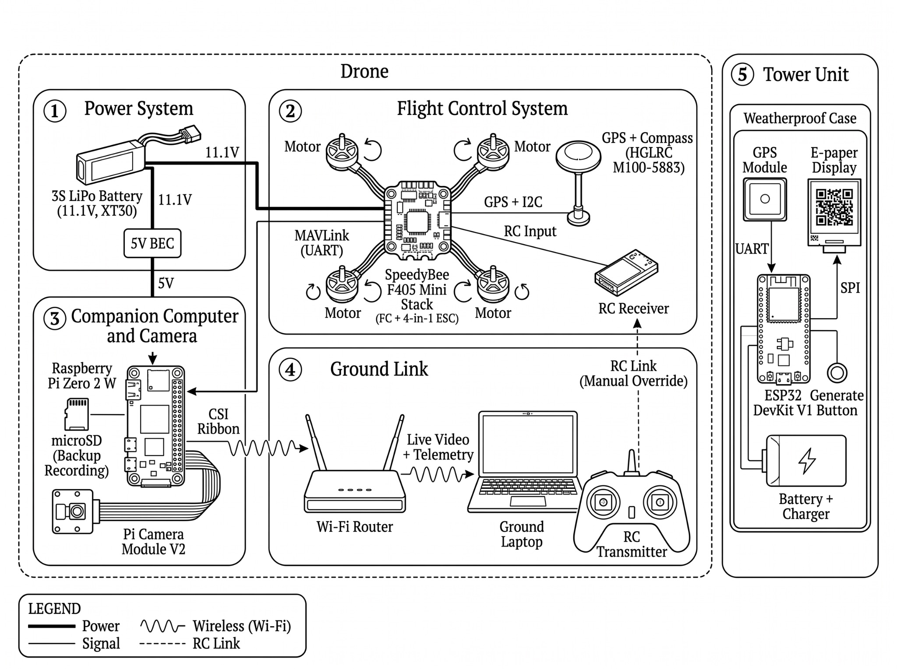

**THESIS PROPOSAL DEFENSE**
**Presentation Content and Flow**

Source: *Chapter 1.docx* (Introduction, Objectives, Framework, Scope, Significance, Methodology) and *Chapter 2.docx* (Review of Related Literature). Items in `[brackets]` are still open in the chapters and must be filled in before the defense.

---

## Presentation Flow

Target length: **18 minutes** of presentation, then open forum. The talk follows one storyline: *the problem → what others have done → the gap → what we will build → how we will build and test it → what it will cost and when it will be done.*

| # | Slide | Part | Time | Presenter | Key message (one sentence) |
| ----- | ----- | ----- | ----- | ----- | ----- |
| 1 | Title | Opening | 0:30 | Lopez | Who we are and what we propose. |
| 2 | Background of the Study | **Problem** | 1:30 | Lopez | Towers grow upward, but pot checking is still manual and sensors cannot see empty pots. |
| 3a–3c | Review of Related Literature + Research Gap | **Problem** | 3:00 | Marvilla | Each piece exists separately; no study combines them for vertical towers. |
| 4 | Conceptual Framework (IPO) | **Solution** | 1:30 | Marvilla | Inputs → RAD process → working inspection system, with a feedback loop. |
| 5 | Research Objectives | **Solution** | 1:00 | Valentino | One general objective, five specific objectives we will be graded against. |
| 6 | Significance of the Study | **Solution** | 1:00 | Valentino | Who benefits and how. |
| 7 | Scope and Delimitation | **Solution** | 1:30 | Valentino | What we will build, and what we deliberately leave out. |
| 8 | Research Methodology (RAD) | **Method** | 1:30 | Fernandez | Four RAD phases, with design and construction repeated as a cycle. |
| 9 | Locale and Participants | **Method** | 0:45 | Fernandez | Where we test and who evaluates. |
| 10 | Research Instruments | **Method** | 0:45 | Fernandez | Three instruments plus system performance tests. |
| 11 | Data Gathering Procedure | **Method** | 0:45 | Fernandez | Approval → interviews → build and test → user evaluation. |
| 12 | Statistical Treatment | **Method** | 1:00 | Fernandez | Weighted mean and SD for users; precision, recall, mAP@50 and counting error for the system. |
| 13 | Proposed System Architecture | **Build** | 2:00 | Lopez | Seven-step flow from QR registration to dashboard; offline-first. |
| 14 | Project Timeline | **Plan** | 0:30 | Lopez | When each RAD phase happens. |
| 15 | Expected Output | **Plan** | 0:30 | Lopez | Deliverables and benefits. |
| 16 | Budget Requirements | **Plan** | 0:30 | Lopez | About ₱27,700 to ₱29,500 in hardware. |
| 17 | Thank You / Open Forum | Closing | — | All | Invite questions. |
|  | Backup slides A–F | Q&A | — | As asked | Show only when a panelist asks. |

> Presenter assignment is a suggestion. Rebalance it so that each member speaks on the part they built or wrote.

---

**Slide 1: Title Slide**
**Thesis Proposal Defense**

* **Computer Vision and Autonomous Drone Inspection for Hydroponic Towers with Web Dashboard Integration**
* Lester Dann G. Lopez (Leader) · Rhoan Joy M. Marvilla · Prince Daniel A. Valentino · Joshua Jing A. Fernandez
* Bachelor of Science in Computer Science (BSCS 4B)
* College of Information Technology Education
* Adviser: Bernadeth B. Liggayu, MIT
* Nueva Vizcaya State University
* `[Date of Proposal Defense]`

*Visual:* NVSU and CITE logos. Use Figure 5 (conceptual illustration of the drone at the tower) as the background image.

*Transition:* "Vertical farms grow upward, and that is where the monitoring problem starts."

---

**Slide 2: Introduction / Background of the Study**
**Overview of the Study**

* **Context:** Vertical hydroponic farms grow crops in stacked tiers to save land (Despommier, 2010), and every tier adds pots that someone has to check.
* **Current situation:** Local farms still record data by hand with inconsistent results (Domingo, 2022). IoT sensors track temperature, pH and nutrients (Chowdhury et al., 2020), but a sensor cannot tell a planted pot from an empty one.
* **Proposed solution:** A small drone flies to each registered tower, scans every face from bottom to top, and YOLOv8 counts lettuce heads and empty pots.
* **Key concepts:** QR code tower registration · GPS + ArUco marker alignment · live YOLOv8 detection on a ground laptop · offline-first web dashboard.
* **Importance:** Gives farmers slot availability per tower without manual walk-throughs, at low cost and without internet at the farm.
* **SDGs:** 2 (Zero Hunger), 9 (Industry, Innovation and Infrastructure), 11 (Sustainable Cities), 12 (Responsible Consumption and Production).

*Visual:* Side-by-side: a farmer checking a tall tower by hand vs. the drone scanning a face.

*Transition:* "We reviewed what others have done in each of these areas."

---

**Slide 3a: Review of Related Literature and Studies**
**Related Literature: Monitoring and Detection**

| Author | Key Findings | Relevance |
| ----- | ----- | ----- |
| Chowdhury et al. (2020); Domingo (2022); Santiago et al. (2025) | IoT systems monitor temperature, light, pH, EC and water level of hydroponic setups and show them on web or mobile apps. | Sensors reduce maintenance work but **none checks if a pot holds a plant**. |
| Domingo (2022) | A lettuce farm in Iloilo recorded farm data by hand, with inconsistent results. | Confirms that local monitoring is still manual. |
| Wang, Wu & Shen (2024) | YOLOv8n detected hydroponic lettuce heads with ~99% precision and recall from 2,240 video frames. | Supports YOLOv8 for lettuce, but **no empty-pot class** and a stable camera. |
| Zhang et al. (2022); Villacrés et al. (2023) | ByteTrack keeps low-score boxes to reduce missed and fragmented tracks; tracking quality strongly affects counting error. | Each pot is counted once; counting error is checked against manual counts. |

**Slide 3b: Review of Related Literature and Studies**
**Related Literature: Navigation, Processing and Data**

| Author | Key Findings | Relevance |
| ----- | ----- | ----- |
| Aslan et al. (2022); Stefas et al. (2019) | Agricultural UAVs focus on open fields and orchards; GPS is unreliable close to the ground. | No UAV study inspects **individual vertical structures**. |
| GPS.gov (n.d.); Wubben et al. (2019); Andrzejewski et al. (2026) | GPS is accurate only to a few meters; ArUco markers with a Raspberry Pi and ArduPilot enable precise **landing**. | GPS brings the drone near; markers do the final alignment. |
| Garrido-Jurado et al. (2014); Lepetit et al. (2009) | ArUco markers are reliably detected even when partly hidden; EPnP/solvePnP gives camera pose from four corners. | Basis of distance, height and face alignment on the tower. |
| Benoit-Cattin et al. (2020); Zhu & Chen (2026) | CNNs on a Raspberry Pi can thermally throttle; offloading to a ground server depends on Wi-Fi quality (15–45 ms). | YOLOv8 runs on the ground laptop; close-range corrections stay on the Pi. |
| Kleppmann et al. (2019); Mirandilla-Santos (2021) | Local-first software keeps working offline; rural Philippine connectivity is uneven. | Offline cache and farmer-initiated sync. |

**Slide 3c: Research Gap**

* IoT studies monitor growing conditions, **not pot occupancy**.
* Lettuce detection studies detect plants from stable viewpoints, **not empty pots or slot positions**.
* Agricultural UAV studies cover fields and orchards, **not single vertical towers**.
* Marker-based UAV studies cover **precision landing**, not holding position beside a vertical face.
* **No reviewed study combines** QR + GPS tower registration, layered GPS → YOLOv8 → ArUco navigation, a face-by-face scan that maps every pot to its slot, and an offline-first dashboard for farms with intermittent internet.

*Visual:* A four-circle diagram (IoT, Computer Vision, UAV, Fiducial Markers) with "This study" in the middle.

*Transition:* "To fill this gap, we framed the study as an Input–Process–Output model."

---

**Slide 4: Conceptual Framework**
**Input–Process–Output (IPO) Model**

| INPUT | PROCESS (Rapid Application Development) | OUTPUT |
| ----- | ----- | ----- |
| **Problem input:** interviews with hydroponic farmers on current monitoring practices | **Requirements Planning:** gather farmer needs; finalize components, scope and evaluation criteria | **Computer Vision and Autonomous Drone Inspection for Hydroponic Towers with Web Dashboard Integration** |
| **Knowledge input:** related literature on vertical farming, computer vision, UAVs and markers | **User Design:** system architecture, database, dashboard UI, mission flow; full-tower scan tested in Gazebo + ArduPilot SITL | Reports **lettuce count, empty pot count and slot availability** for each tower |
| **Hardware:** drone (SpeedyBee F405 Mini, HGLRC M100-5883 GPS, Raspberry Pi Zero 2 W, Pi Camera V2); tower unit (ESP32, GPS, e-paper QR display); ArUco markers; ground laptop | **Rapid Construction:** build drone, tower frame and tower unit; label dataset in Supabox; train YOLOv8; develop streaming, alignment and dashboard in short cycles | |
| **Software:** YOLOv8, ArduPilot, OpenCV, Supabase, Next.js | **Cutover:** end-to-end tests in the open outdoor area; precision, recall, mAP@50, counting error, alignment and scan success; user evaluation (weighted mean) | |

**Feedback loop:** results of flight tests, detection tests and user evaluations return to the earlier stages for the next iteration.

*Visual:* Draw this as three columns with an arrow returning from Output to Input. Keep Figure 1 (Conceptual Framework) as Backup Slide A.

*Transition:* "From this framework come our objectives."

---

**Slide 5: Research Objectives**
**General Objective**
To design and develop an autonomous drone-based monitoring system that registers vertical hydroponic towers through a location-based QR code, navigates to each tower using GPS, aligns itself using computer vision and visual markers, scans every face of the tower in an open space, detects lettuce plants and empty planting pots using computer vision, and displays tower-level records on a web-based dashboard.

**Specific Objectives**

1. To identify the existing tools, processes and challenges in monitoring vertical hydroponic farming to establish the system's baseline requirements.
2. To design and develop a tower unit that generates a location-based QR code, and a web dashboard for QR-based tower registration, scan requests and inspection records.
3. To develop an autonomous navigation and alignment method that combines GPS waypoints, YOLOv8 tower detection, and QR code and ArUco marker positioning to scan every face of a tower.
4. To develop a YOLOv8 model that detects lettuce heads and empty pots from live aerial video and matches each detection to its exact pot, integrated with drone telemetry, the offline cache and the web dashboard.
5. To evaluate the system in terms of detection and counting accuracy, alignment and scan success, and its usefulness, ease of use and user satisfaction.

*Speaker note:* Objective 5 maps directly to Slide 12. Say so here.

---

**Slide 6: Significance of the Study**

* **Hydroponic Farmers (practical):** Less time checking towers pot by pot, especially the upper levels; updated counts help plan replanting, harvesting and space use.
* **Farm Managers and Workers (practical):** A clear per-tower record of occupancy and inspection history, with fewer counting errors.
* **Students and Researchers (academic):** A reference for drone-based crop monitoring; the labeled dataset can be reused for plant health, pest or harvest-readiness studies.
* **Academic Community (academic):** Adds to the body of knowledge on smart farming, robotics and applied computer vision.
* **Technical contribution:** Extends marker-based alignment from landing pads to the vertical faces of a tower, and maps each detection to a specific slot.
* **Local Community and Agricultural Offices:** Guides the promotion of affordable urban and vertical farming technology for food security.

---

**Slide 7: Scope and Delimitation**
**Scope**

* QR code tower registration through an ESP32 tower unit with GPS and an e-paper display.
* GPS navigation to the tower; visual alignment with YOLOv8, the QR code and ArUco markers; bottom-to-top scan of every face.
* Live YOLOv8 detection of lettuce and empty pots on the ground laptop, matched to each pot by face, level and position.
* SQLite offline cache, farmer-initiated upload to Supabase, and a Next.js dashboard (register, map, request scan, live scan, sync, history).
* Evaluation of detection, counting, slot matching, alignment, scan success, streaming, flight time, and usefulness, ease of use and satisfaction.

**Delimitations**

* Prototype on a structural frame only; no working watering or nutrient system.
* **Lettuce only**; classifies a slot as occupied or empty, with no disease, pest, growth-stage or weight assessment.
* Open, obstacle-free outdoor area with GPS; no obstacle avoidance, indoor or GPS-denied flight; 2D RGB only, no LiDAR.
* Drone must stay within local Wi-Fi range (`[Wi-Fi range, m]`); about 3–5 minutes of flight per battery, one tower per flight.
* Fair weather only, sustained wind ≤ `[maximum wind speed, km/h]`; no rain or night flights; no cellular, cloud GPU or commercial deployment.

---

**Slide 8: Research Methodology**
**Research Design**

* **Developmental research design** with a **mixed-method** approach: qualitative (farmer interviews) and quantitative (system performance tests and user ratings).
* **Rapid Application Development (RAD)** model (Martin, 1991), chosen because the drone, the YOLOv8 model and the dashboard each need several build-and-test rounds before they work together.
* **Phase 1 – Requirements Planning:** interviews, site observation, component selection, SWOT analysis.
* **Phase 2 – User Design:** architecture, hardware and power design, mission and slot localization flow, Supabase schema, dashboard UI; full-tower scan simulated in Gazebo with ArduPilot SITL.
* **Phase 3 – Rapid Construction:** Stage 1 (dashboard, tower unit, dataset, simulation, manual flight); Stage 2 (Pi and camera on the drone, visual alignment, full pipeline).
* **Phase 4 – Cutover:** model, flight, streaming, offline sync and end-to-end tests; user evaluation; final documentation.

---

**Slide 9: Locale and Participants**
**Research Locale**

* Flight tests: `[testing site]`, an open, obstacle-free outdoor area with available GPS signal.
* Needs assessment interviews: hydroponic farmers at `[farm name and location]`.
* Selected because it allows safe drone operation and a clear view of the tower frame.

**Participants/Respondents**

* **Population:** Hydroponic farmers (owners, managers, workers): `[no.]`; IT experts from CITE, NVSU: `[no.]`; Total: `[no.]`.
* **Sampling technique:** Purposive sampling, because respondents have direct experience in hydroponic farming or system development.
* **Sample size:** Total enumeration of the identified population: `[no.]`.

---

**Slide 10: Research Instruments**
**Instruments to Use**

* **Interview Questionnaire (farmers):** six parts: profile, farm setup, current monitoring practices, challenges (5-point scale), views on the proposed system, open-ended questions.
* **Site Observation Sheet:** tower height, levels, pots per level, open space for the drone, obstacles, lighting, wind, GPS and network signal.
* **Survey Questionnaire:** adapted from Lund's (2001) USE Questionnaire, covering usefulness, ease of use and user satisfaction on a 5-point Likert scale, with open-ended comments.
* **System Evaluation Tool:** test logs for detection (precision, recall, mAP@50), counting error, slot matching, alignment, scan completion, stream delay and frame loss, and flight time.

**Validation**

* **Expert Validation:** interview questionnaire submitted to the thesis adviser for suggestions and approval. `[Add: content validation by IT and agriculture experts, if required by the panel]`
* **Pilot Testing:** `[Not yet in Chapter 1. Propose a trial run of the questionnaires with a few non-respondent farmers or students.]`
* **Reliability Testing:** `[Not yet in Chapter 1. Propose Cronbach's alpha on the pilot results of the adapted USE Questionnaire.]`

---

**Slide 11: Data Gathering Procedure**
**Steps**

1. **Secure Approval:** adviser approval of the questionnaire; letter of request; approval from school authorities and farm owners.
2. **Validation of Instruments:** adviser review of the interview questionnaire and the adapted USE Questionnaire.
3. **Data Collection:** face-to-face interviews (~15 minutes each) with informed consent; site observation sheet; tower photos (no people) added to the Supabox dataset; test flights and detection tests in the testing area.
4. **Data Processing:** interview notes coded into themes; test results recorded per tower and per flight; USE ratings tallied per category.
5. **Data Analysis:** thematic analysis updates the SWOT; performance metrics computed; weighted mean and SD interpreted using the scale on Slide 12.

*Ethics (one line on the slide):* voluntary participation, Data Privacy Act of 2012 (RA 10173), supervised flights following CAAP PCAR Part 11 (≥ 30 m from non-participants), manual RC override.

---

**Slide 12: Statistical Treatment of Data**

* **Weighted mean** (x̄ = Σfx / n) and **standard deviation** per category: usefulness, ease of use, user satisfaction.
* **Precision** = TP / (TP + FP) · **Recall** = TP / (TP + FN) · **mAP@50** for the YOLOv8 model on unseen tower images.
* **Counting error per tower** = |system count − manual count| / manual count × 100, for lettuce and empty pots.
* **Slot matching accuracy** = correctly assigned slots / total slots.
* **Flight measures:** alignment success rate, mean alignment error (cm), full-tower scan completion rate, average stream delay and frame loss, flight time per tower.
* **Thematic analysis** for the qualitative interview data.

| Scale | Range | Descriptor | Interpretation |
| :---: | ----- | ----- | ----- |
| 5 | 4.61 – 5.00 | Strongly Agree | Highly Acceptable |
| 4 | 3.41 – 4.60 | Agree | Acceptable |
| 3 | 2.61 – 3.40 | Neutral | Fair |
| 2 | 1.81 – 2.60 | Disagree | Not Acceptable |
| 1 | 1.00 – 1.80 | Strongly Disagree | Highly Not Acceptable |

---

**Slide 13: Proposed System / Project Architecture**

* **System Architecture**

  > **1. Tower Unit** (ESP32 + GPS + e-paper) shows a QR code with tower ID, GPS and checksum
  >   ↓
  > **2. Farmer's Smartphone** scans the QR code → registers the tower and requests a scan
  >   ↓
  > **Supabase** (towers, locations, scan requests) → downloaded to the **Ground Laptop** when online
  >   ↓
  > **3. Drone** (ArduPilot) flies by GPS waypoint to the approach point
  >   ↓
  > **4. Alignment and Scan:** YOLOv8 finds the tower; the Pi uses the QR code and ArUco markers to hold distance, height and face; scans each face bottom to top
  >   ↓
  > **5. Ground Laptop** receives live video over local Wi-Fi → YOLOv8 + ByteTrack → slot mapping → **SQLite offline cache** (backup recording fills gaps after landing)
  >   ↓
  > **6. Sync Center** uploads results to Supabase when the farmer chooses and internet is available
  >   ↓
  > **7. Next.js Web Dashboard** shows lettuce, empty pots and slot availability per tower

  **Key Features**

* QR code tower registration with GPS location and map view (Leaflet + OpenStreetMap).
* Layered navigation: GPS → YOLOv8 tower detection → QR code and ArUco alignment, with ArduPilot stabilization.
* Full-tower, face-by-face scan that maps each detection to its pot by face, level and position.
* Live Scan view on the local dashboard; RC transmitter kept as manual override.
* Offline-first: works on local Wi-Fi only; Sync Center uploads without duplicates.
* Inspection history and exportable datasets on the web dashboard.

*Speaker note:* Explain the three design decisions: (1) detection runs on the ground laptop, not the Pi, to avoid thermal throttling; (2) close-range corrections stay on the Pi because Wi-Fi latency varies; (3) the system works without internet. Mention the failsafes: return to launch on lost markers, high wind or low battery.

---

**Slide 14: Project Timeline (Gantt Chart)**

| Activities | Month 1 | Month 2 | Month 3 | Month 4 | Month 5 | Month 6 |
| ----- | ----- | ----- | ----- | ----- | ----- | ----- |
| Proposal Writing and Defense | ■ |  |  |  |  |  |
| Requirements Planning (interviews, site observation, SWOT) | ■ | ■ |  |  |  |  |
| Validation of Instruments | ■ | ■ |  |  |  |  |
| User Design (architecture, UI, Gazebo/SITL simulation) |  | ■ | ■ |  |  |  |
| Rapid Construction – Stage 1 (dashboard, tower unit, dataset, manual flight) |  | ■ | ■ | ■ |  |  |
| Rapid Construction – Stage 2 (Pi + camera, alignment, full pipeline) |  |  | ■ | ■ | ■ |  |
| Cutover Testing (model, flight, streaming, sync, end-to-end) |  |  |  | ■ | ■ |  |
| User Evaluation and Data Analysis |  |  |  |  | ■ | ■ |
| Documentation and Final Defense |  |  |  |  |  | ■ |

`[Proposed schedule. Chapter 1 does not set dates; replace Month 1–6 with actual months of SY 2026–2027.]`

---

**Slide 15: Expected Output**

* **Deliverables**
  * Working prototype drone (SpeedyBee F405 Mini + ArduPilot, Raspberry Pi Zero 2 W, Pi Camera V2) with autonomous full-tower scan.
  * Tower unit (ESP32, GPS, e-paper) that generates the location-based QR code, plus a tower frame with ArUco markers.
  * Trained YOLOv8 model (lettuce, empty pot, tower frame) and the labeled image dataset.
  * Local dashboard with offline cache and Sync Center, and the Next.js + Supabase web dashboard.
  * Test results and the final thesis manuscript.
* **Anticipated Benefits**
  * Per-tower lettuce count, empty pot count and slot availability without manual walk-throughs.
  * A reusable dataset and method for future drone-based crop monitoring research.

---

**Slide 16: Budget Requirements (Optional)**

| Item | Cost |
| ----- | ----- |
| Drone (frame, flight controller stack, motors, propellers, Raspberry Pi, camera, GPS, batteries, charger, regulator, RC set, microSD) | ₱21,787 – ₱22,307 |
| Fabrication (TPU and PLA/ABS filament, screws and standoffs) | ₱1,450 – ₱2,700 |
| Tower Unit and Markers (ESP32, GPS, e-paper, button, battery, IP65 case, 20 ArUco markers) | ₱4,450 |
| Local Wi-Fi (ground laptop hotspot) | ₱0 |
| Printing | ₱`[to be estimated]` |
| Transportation | ₱`[to be estimated]` |
| Miscellaneous | ₱`[to be estimated]` |

**Total Budget:** ₱27,687 – ₱29,457 (hardware only, from Table 4 of Chapter 1)

*Note on the slide:* Excludes the tower frame, lettuce and pots, and the ground laptop.

---

**Slide 17: Thank You / Open Forum**

**Questions, Comments, and Suggestions**

*Visual:* Repeat the title and Figure 5. Keep the backup slides ready.

---

## Backup Slides (show only when asked)

| Slide | Content | Likely panel question |
| ----- | ----- | ----- |
| **A** | Figure 1. Conceptual Framework (steps 1a–7b) | "Walk us through the whole flow." |
| **B** | Figure 7. Technical Design (power, flight control, companion computer, ground link, tower unit) | "How is the hardware wired? What powers the Pi?" |
| **C** | SWOT Analysis (Figure 4) | "What are the weaknesses and risks?" |
| **D** | Table 1 and Table 2: hardware and software components | "Why these components?" |
| **E** | Safety and failsafes: fair weather, wind limit, RTL on lost markers, high wind or low battery; CAAP PCAR Part 11 | "Is it safe? Is it legal to fly?" |
| **F** | Why YOLOv8 on the laptop instead of the Pi (Benoit-Cattin et al., 2020; Zhu & Chen, 2026) | "Why not run detection on the drone?" |

**Still to prepare** (suggested in the template, not yet in Chapters 1–2): Database Design (ERD) of the Supabase schema, Use Case Diagram of the dashboard, Network/Deployment Diagram, and prototype screenshots once available.

---

**Presentation Guidelines**

* Maximum 6 bullet points per slide
* Use visual diagrams instead of lengthy paragraphs
* Maintain consistent colors and layouts
* Allocate 15–20 minutes for the proposal presentation
